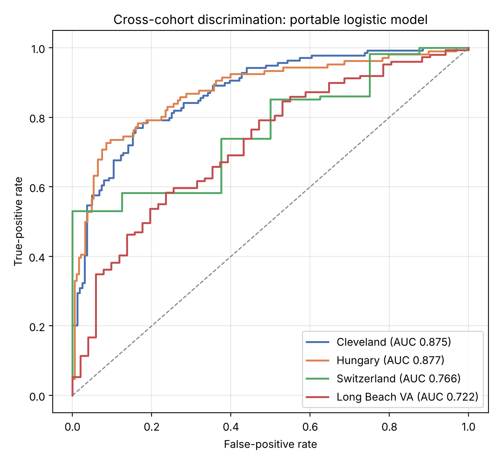
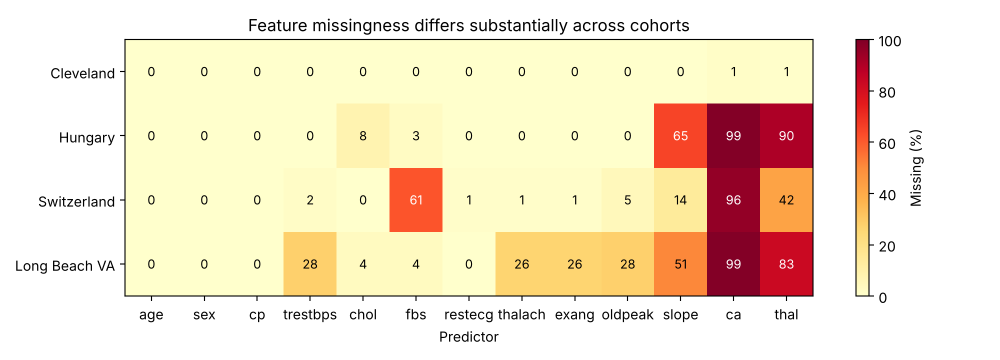

# Cross-Cohort Heart Disease Detection Using Interpretable and Calibration-Aware Machine Learning

Code, data and results for **Paper ID 473**, 2nd International Conference on Computing,
Communication and Sustainable Energy Technologies (**I3CSET-2026**), Track 7: Artificial
Intelligence, Machine Learning & Data Science.

**Authors:** Kanhaiya Kumar Sahani, Anurag Kumar Ojha, Asad Khan &nbsp;·&nbsp; **Mentor:** Mrs. Shanu Verma
Department of Information Technology, Galgotias College of Engineering and Technology, Greater Noida

**Live results and risk calculator:** [huggingface.co/spaces/anurag2004/cross-cohort-heart-disease](https://huggingface.co/spaces/anurag2004/cross-cohort-heart-disease)
**Frozen models:** [huggingface.co/anurag2004/cross-cohort-heart-disease](https://huggingface.co/anurag2004/cross-cohort-heart-disease)

> A heart-disease model that scores well in one hospital must be tested externally, and its
> probabilities checked, before anyone trusts it in another hospital.

---

## What the study does

Most heart-disease classifiers are trained and tested on a random split of the same 303
Cleveland patients. This study trains on **Cleveland** only and tests the frozen model,
**without refitting**, on 617 patients from three other hospitals.

| Cohort | Role | Records | With disease | Prevalence | Median age | Female |
|---|---|---|---|---|---|---|
| Cleveland, USA | Development | 303 | 139 | 45.9% | 56 | 97 (32.0%) |
| Hungary | External test | 294 | 106 | 36.1% | 49 | 81 (27.6%) |
| Switzerland | External test | 123 | 115 | 93.5% | 56 | 10 (8.1%) |
| Long Beach VA, USA | External test | 200 | 149 | 74.5% | 60 | 6 (3.0%) |

- **Models:** L2-regularised logistic regression (main, interpretable) and a random forest
  (500 trees, depth 5, minimum leaf 5). No oversampling, class weighting or hyperparameter search.
- **Portable model:** vessel count, thalassemia and ST slope are missing in up to 99% of
  external records, so they are dropped. Ten routinely collected predictors remain.
- **Validation:** 10 x repeated stratified 5-fold cross-validation inside Cleveland, with all
  preprocessing fitted inside each training fold; then one refit on all 303 records, frozen.
- **Reported:** AUC, average precision, Brier score, sensitivity and specificity at a 0.50
  cut-off, calibration intercept and slope, 95% confidence intervals from 2,000 bootstrap
  resamples, and an exploratory comparison by sex.

## Results (portable logistic model)

| Evaluation | Records | AUC (95% CI) | Brier | Sensitivity | Specificity | Cal. intercept | Cal. slope |
|---|---|---|---|---|---|---|---|
| Cleveland (internal CV) | 303 | 0.875 (0.835–0.913) | 0.143 | 0.755 | 0.841 | −0.046 | 0.972 |
| Hungary | 294 | 0.877 (0.832–0.919) | 0.135 | 0.783 | 0.814 | −0.551 | 0.909 |
| Switzerland | 123 | 0.766 (0.620–0.899) | 0.267 | 0.609 | 0.625 | 2.968 | 0.585 |
| Long Beach VA | 200 | 0.722 (0.642–0.797) | 0.188 | 0.785 | 0.529 | 0.664 | 0.488 |
| External pooled | 617 | 0.815 (0.780–0.848) | 0.179 | 0.730 | 0.749 | 0.405 | 0.702 |

- Ranking ability transfers only partly: AUC falls from 0.875 in Cleveland to 0.722–0.877 outside it.
- Calibration does not transfer: risk is strongly under-predicted in the 93.5%-prevalence Swiss cohort.
- Dropping the three poorly available tests costs 0.038 internal AUC (0.913 to 0.875).
- External sensitivity was 0.400 in women and 0.754 in men. Only 25 external women had
  disease, so this is a warning to test further, not proof of bias.

| ROC curves | Calibration curves |
|:---:|:---:|
|  |  |

| Predictor missingness | Logistic coefficients |
|:---:|:---:|
|  |  |

All four models, every confidence interval and the sex-stratified table are in
[`outputs/`](outputs/) (`table3_internal_cv.csv`, `table4_external.csv`,
`table5_sex_subgroups.csv`, `results.xlsx`).

## Run it

```bash
git clone https://github.com/intojhanurag/cross-cohort-heart-disease.git
```

```bash
cd cross-cohort-heart-disease
```

```bash
pip install -r requirements.txt
```

```bash
python run_analysis.py
```

```bash
python verify_paper_numbers.py
```

```bash
streamlit run app.py
```

| Command | What it does | Time |
|---|---|---|
| `python run_analysis.py` | Rebuilds every table and figure from `data/raw/` and writes `outputs/` | about 75 s on 4 cores |
| `python run_analysis.py --quick` | Same, with 200 instead of 2,000 bootstrap resamples (only the confidence intervals change) | slightly faster |
| `python verify_paper_numbers.py` | Compares 121 values printed in the paper with the run you just made | 1 s |
| `streamlit run app.py` | Dashboard: data, results, coefficients, single-patient scoring | live |
| `python sensitivity_chol_zero.py` | Sensitivity check for zero-coded cholesterol (see Limitations) | 1 s |

No Python at hand? Download [`outputs/report.html`](outputs/report.html) and open it in a
browser: one self-contained page with all tables and figures.

## Method

| Step | Setting |
|---|---|
| Outcome | `num` > 0 (at least 50% narrowing in a major vessel) vs `num` = 0 |
| Portable model | 10 predictors: age, sex, cp, trestbps, chol, fbs, restecg, thalach, exang, oldpeak |
| Full model | the 10 above plus slope, ca, thal (largely missing outside Cleveland) |
| Preprocessing | continuous: median imputation + standardisation; categorical: most-frequent imputation + one-hot (unseen categories ignored). Fitted inside each training fold |
| Logistic regression | L2 penalty, C = 1, liblinear solver |
| Random forest | 500 trees, depth 5, minimum leaf 5, sqrt feature sampling |
| Internal validation | 10 x repeated stratified 5-fold CV on Cleveland; the 10 out-of-fold probabilities per record are averaged |
| External validation | pipeline refitted once on all 303 Cleveland records, then frozen |
| Threshold | 0.50 for sensitivity, specificity, precision, F1, accuracy |
| Calibration | logistic recalibration `y ~ a + b * logit(p)`: intercept `a` (ideal 0), slope `b` (ideal 1). Calibration-in-the-large is also saved |
| Uncertainty | percentile 95% CI from 2,000 participant-level bootstrap resamples |
| Seed | 20260904 |

## Data

The four processed files of the UCI Heart Disease repository are included unmodified in
[`data/raw/`](data/raw/), with SHA-256 hashes. Each has 14 comma-separated columns and `?`
for missing values:

`age, sex, cp, trestbps, chol, fbs, restecg, thalach, exang, oldpeak, slope, ca, thal, num`

| File | Cohort | Records |
|---|---|---|
| `processed.cleveland.data` | Cleveland Clinic Foundation, USA | 303 |
| `processed.hungarian.data` | Hungarian Institute of Cardiology, Budapest | 294 |
| `processed.switzerland.data` | University Hospitals Zurich and Basel | 123 |
| `processed.va.data` | V.A. Medical Center, Long Beach, USA | 200 |

Source: Janosi A, Steinbrunn W, Pfisterer M, Detrano R. *Heart Disease.* UCI Machine Learning
Repository, 1989. doi:10.24432/C52P4X (CC BY 4.0). See [`data/README.md`](data/README.md).

## Repository layout

```
data/raw/                  four UCI cohort files + SHA256SUMS
run_analysis.py            the whole analysis
verify_paper_numbers.py    paper values vs. reproduced values
sensitivity_chol_zero.py   zero-cholesterol sensitivity check
build_report.py            builds outputs/report.html
app.py                     Streamlit dashboard
requirements.txt
outputs/
  table2..5 *.csv, results.xlsx, predictions.csv (one row per patient)
  figures/fig1..4 *.png
  run_manifest.json        seed, package versions, data hashes
  paper_vs_reproduced.csv  output of verify_paper_numbers.py
  console_log.txt          console output of the committed run
  models/                  fitted pipelines (.joblib, created on each run, not committed)
```

## Reproducibility notes

- Point estimates are deterministic for a given seed. The committed run matches
  all 91 point estimates in the paper to within 0.001.
- Three random-forest values differ from the paper in the third decimal
  (calibration slope 1.508 vs 1.507, Hungary Brier 0.132 vs 0.131, Long Beach VA
  AUC 0.750 vs 0.749).
- Confidence-interval bounds come from bootstrap resampling and depend on the
  random-number stream. They agree with the paper to within 0.01, except the
  random-forest interval for Switzerland (0.522–0.983 here, 0.544–0.981 in the
  paper), which rests on only 8 disease-free patients.
- Package versions are recorded in `outputs/run_manifest.json`.

## Limitations

- The data are from about 1988 and from patients already referred for angiography, so this
  is not a population screening tool.
- Only 303 development records; Switzerland has only 8 disease-free patients.
- Cholesterol is recorded as 0 for all 123 Switzerland records and 49 of 200 Long Beach VA
  records. The main analysis keeps the UCI values unchanged. Treating them as missing leaves
  per-site AUC almost unchanged but improves Switzerland's Brier score from 0.267 to 0.155
  and raises the pooled external AUC from 0.815 to 0.853.
- The sex comparison is exploratory and underpowered. No ethnicity or socioeconomic data.

**This is a research prototype. No model here is suitable for clinical use.**
