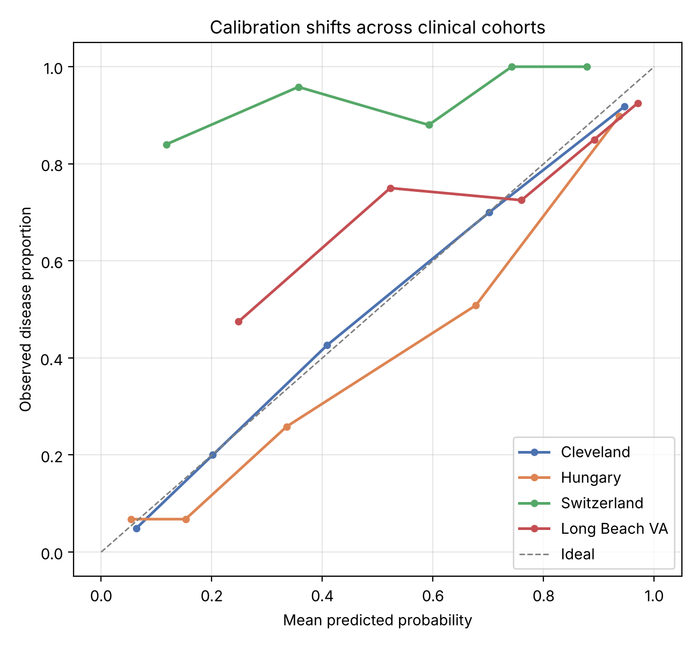
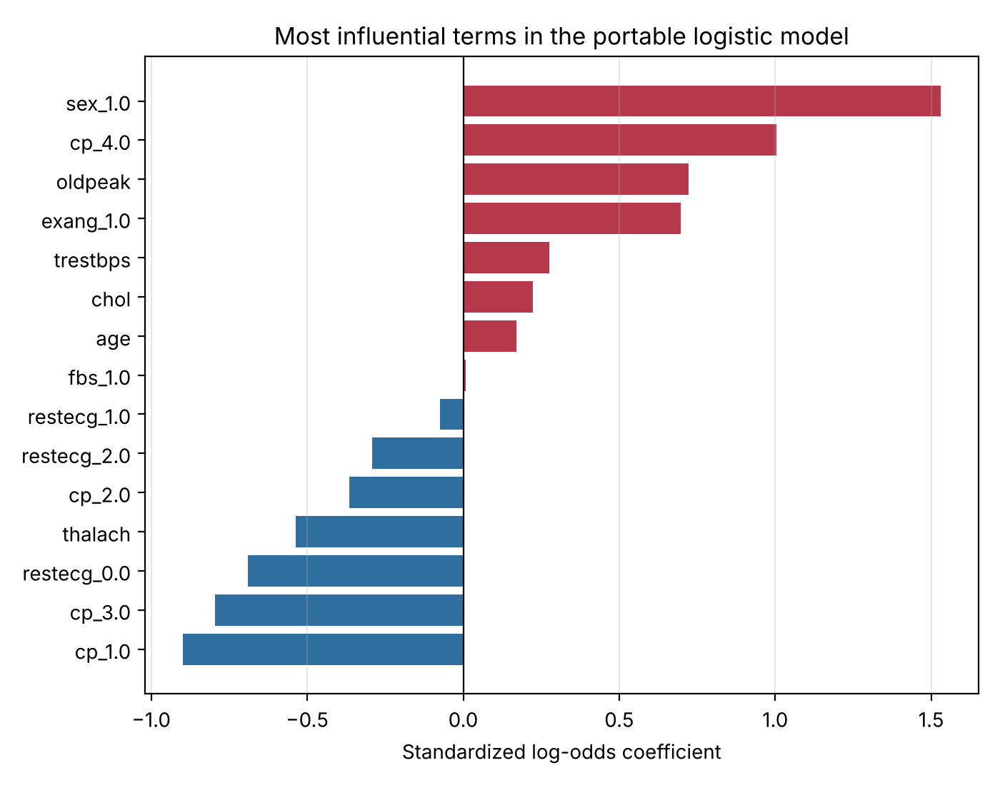

# Cross-Cohort Heart Disease Detection Using Interpretable and Calibration-Aware Machine Learning

Code, data and results for **Paper ID 473**, 2nd International Conference on Computing,
Communication and Sustainable Energy Technologies (**I3CSET-2026**), Track 7: Artificial
Intelligence, Machine Learning & Data Science.

**Authors:** Kanhaiya Kumar Sahani, Anurag Kumar Ojha, Asad Khan &nbsp;·&nbsp; **Mentor:** Mrs. Shanu Verma
Department of Information Technology, Galgotias College of Engineering and Technology, Greater Noida

> A heart-disease model that scores well in one hospital must be tested externally, and its
> probabilities checked, before anyone trusts it in another hospital.

Everything for the study is in [`heart-disease-cross-cohort/`](heart-disease-cross-cohort/).

---

## What the study does

Most heart-disease classifiers are trained and tested on a random split of the same 303
Cleveland patients. This study trains on **Cleveland** only and tests the frozen model,
**without refitting**, on 617 patients from three other hospitals.

| Cohort | Role | Records | With disease | Prevalence | Median age | Female |
|---|---|---|---|---|---|---|
| Cleveland, USA | Development | 303 | 139 | 45.9% | 56 | 97 (32.0%) |
| Hungary | External test | 294 | 106 | 36.1% | 49 | 81 (27.6%) |
| Switzerland | External test | 123 | 115 | 93.5% | 56 | 10 (8.1%) |
| Long Beach VA, USA | External test | 200 | 149 | 74.5% | 60 | 6 (3.0%) |

- **Models:** L2-regularised logistic regression (main, interpretable) and a random forest
  (500 trees, depth 5, minimum leaf 5). No oversampling, class weighting or hyperparameter search.
- **Portable model:** vessel count, thalassemia and ST slope are missing in up to 99% of
  external records, so they are dropped. Ten routinely collected predictors remain.
- **Validation:** 10 x repeated stratified 5-fold cross-validation inside Cleveland, with all
  preprocessing fitted inside each training fold; then one refit on all 303 records, frozen.
- **Reported:** AUC, average precision, Brier score, sensitivity and specificity at a 0.50
  cut-off, calibration intercept and slope, 95% confidence intervals from 2,000 bootstrap
  resamples, and an exploratory comparison by sex.

## Results (portable logistic model)

| Evaluation | Records | AUC (95% CI) | Brier | Sensitivity | Specificity | Cal. intercept | Cal. slope |
|---|---|---|---|---|---|---|---|
| Cleveland (internal CV) | 303 | 0.875 (0.835–0.913) | 0.143 | 0.755 | 0.841 | −0.046 | 0.972 |
| Hungary | 294 | 0.877 (0.832–0.919) | 0.135 | 0.783 | 0.814 | −0.551 | 0.909 |
| Switzerland | 123 | 0.766 (0.620–0.899) | 0.267 | 0.609 | 0.625 | 2.968 | 0.585 |
| Long Beach VA | 200 | 0.722 (0.642–0.797) | 0.188 | 0.785 | 0.529 | 0.664 | 0.488 |
| External pooled | 617 | 0.815 (0.780–0.848) | 0.179 | 0.730 | 0.749 | 0.405 | 0.702 |

- Ranking ability transfers only partly: AUC falls from 0.875 in Cleveland to 0.722–0.877 outside it.
- Calibration does not transfer: risk is strongly under-predicted in the 93.5%-prevalence Swiss cohort.
- Dropping the three poorly available tests costs 0.038 internal AUC (0.913 to 0.875).
- External sensitivity was 0.400 in women and 0.754 in men. Only 25 external women had
  disease, so this is a warning to test further, not proof of bias.

| ROC curves | Calibration curves |
|:---:|:---:|
|  |  |

| Predictor missingness | Logistic coefficients |
|:---:|:---:|
|  |  |

All four models, every confidence interval and the sex-stratified table are in
[`heart-disease-cross-cohort/outputs/`](heart-disease-cross-cohort/outputs/).

## Run it

```bash
git clone https://github.com/intojhanurag/lung-disease-prediction-vgg16.git
```

```bash
cd lung-disease-prediction-vgg16/heart-disease-cross-cohort
```

```bash
pip install -r requirements.txt
```

```bash
python run_analysis.py
```

```bash
python verify_paper_numbers.py
```

```bash
streamlit run app.py
```

| Command | What it does |
|---|---|
| `python run_analysis.py` | Rebuilds every table and figure from the raw data (about 75 seconds on 4 cores) |
| `python verify_paper_numbers.py` | Compares 121 values printed in the paper with the run you just made |
| `streamlit run app.py` | Dashboard with the data, results, coefficients and single-patient scoring |
| `python sensitivity_chol_zero.py` | Sensitivity check for zero-coded cholesterol |

No Python at hand? Download
[`outputs/report.html`](heart-disease-cross-cohort/outputs/report.html) and open it in a
browser: one self-contained page with all tables and figures.

## Data

The four processed files of the UCI Heart Disease repository are included unmodified in
[`heart-disease-cross-cohort/data/raw/`](heart-disease-cross-cohort/data/raw/), with SHA-256
hashes. Each has 14 comma-separated columns and `?` for missing values:

`age, sex, cp, trestbps, chol, fbs, restecg, thalach, exang, oldpeak, slope, ca, thal, num`

| File | Cohort | Records |
|---|---|---|
| `processed.cleveland.data` | Cleveland Clinic Foundation, USA | 303 |
| `processed.hungarian.data` | Hungarian Institute of Cardiology, Budapest | 294 |
| `processed.switzerland.data` | University Hospitals Zurich and Basel | 123 |
| `processed.va.data` | V.A. Medical Center, Long Beach, USA | 200 |

Source: Janosi A, Steinbrunn W, Pfisterer M, Detrano R. *Heart Disease.* UCI Machine Learning
Repository, 1989. doi:10.24432/C52P4X (CC BY 4.0).

## Repository layout

```
heart-disease-cross-cohort/     the I3CSET-2026 study
├── data/raw/                   four UCI cohort files + SHA256SUMS
├── run_analysis.py             the whole analysis
├── verify_paper_numbers.py     paper values vs. reproduced values
├── sensitivity_chol_zero.py    zero-cholesterol sensitivity check
├── build_report.py             builds outputs/report.html
├── app.py                      Streamlit dashboard
├── requirements.txt
└── outputs/                    tables (CSV, XLSX), figures, per-patient predictions,
                                run manifest (seed, versions, data hashes), report.html

app.py, train.py, model/, ...   earlier project: pneumonia detection from chest X-rays
```

## Limitations

- The data are from about 1988 and from patients already referred for angiography, so this
  is not a population screening tool.
- Only 303 development records; Switzerland has only 8 disease-free patients.
- Cholesterol is recorded as 0 for all 123 Switzerland records and 49 of 200 Long Beach VA
  records. The main analysis keeps the UCI values unchanged. Treating them as missing leaves
  per-site AUC almost unchanged but improves Switzerland's Brier score from 0.267 to 0.155
  and raises the pooled external AUC from 0.815 to 0.853.
- The sex comparison is exploratory and underpowered. No ethnicity or socioeconomic data.

**This is a research prototype. No model here is suitable for clinical use.**

## Earlier project in this repository

The repository also holds the team's earlier major project, a VGG16 transfer-learning app
that classifies chest X-rays as normal or pneumonia (Flask, Grad-CAM). Its files remain at
the repository root and its documentation is in [`LUNG_XRAY_APP.md`](LUNG_XRAY_APP.md).
